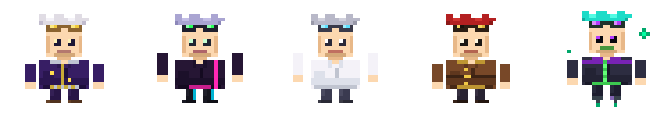
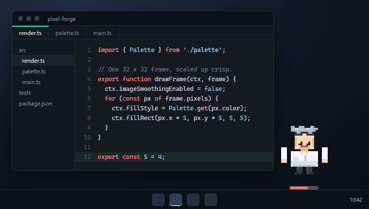
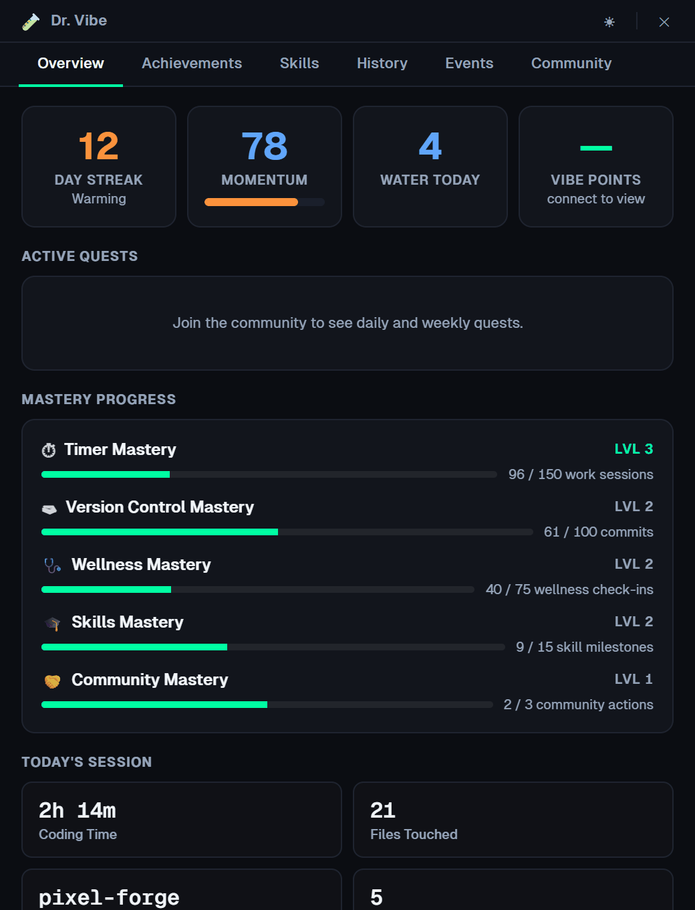
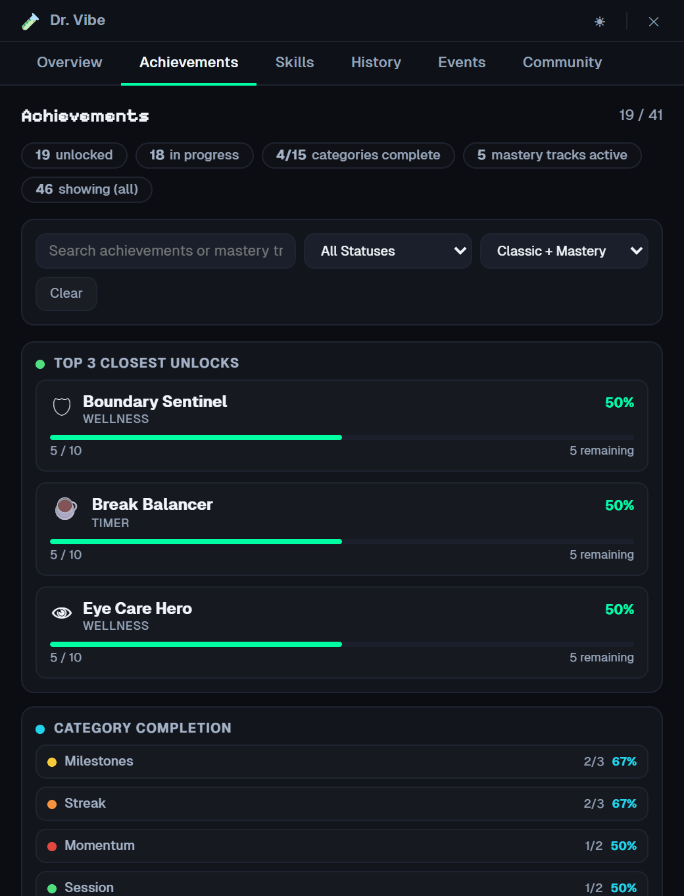
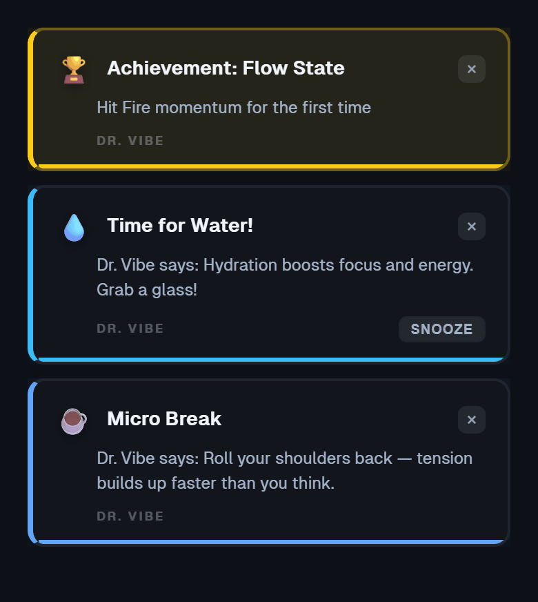
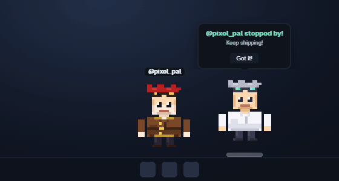
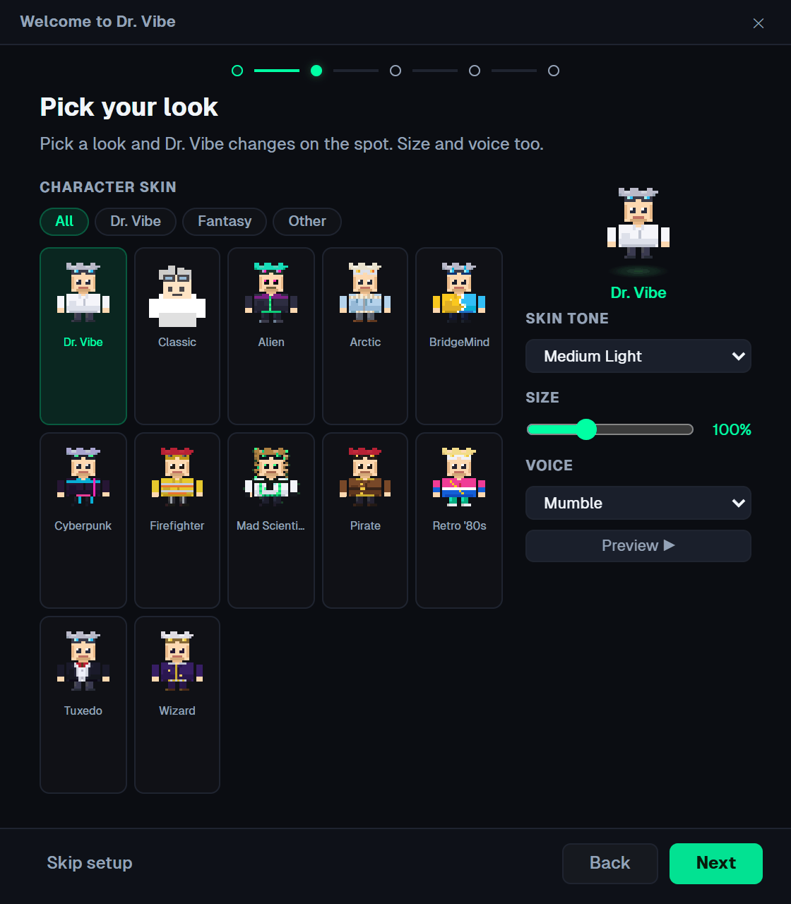
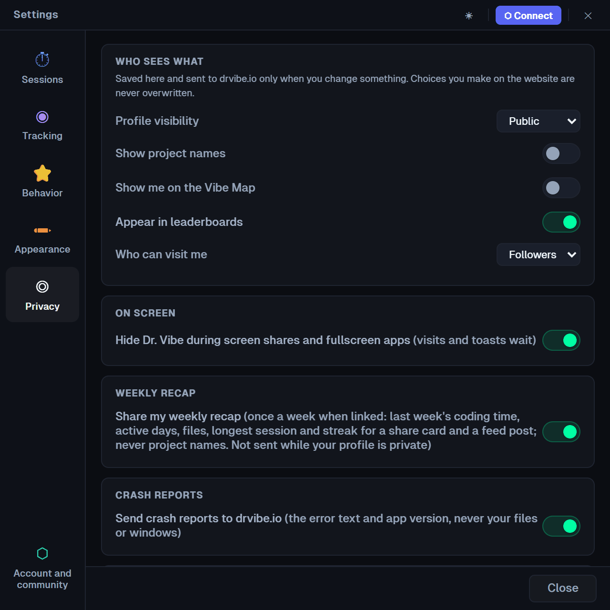
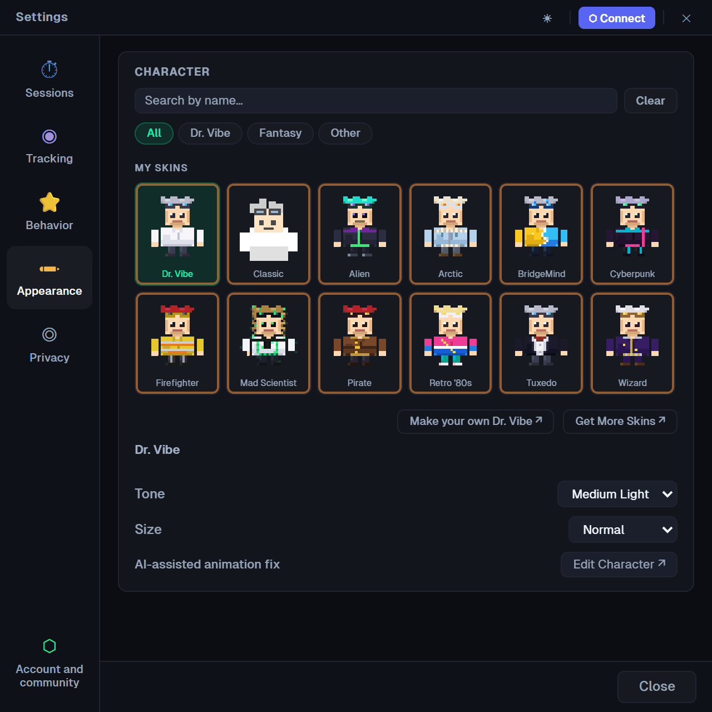
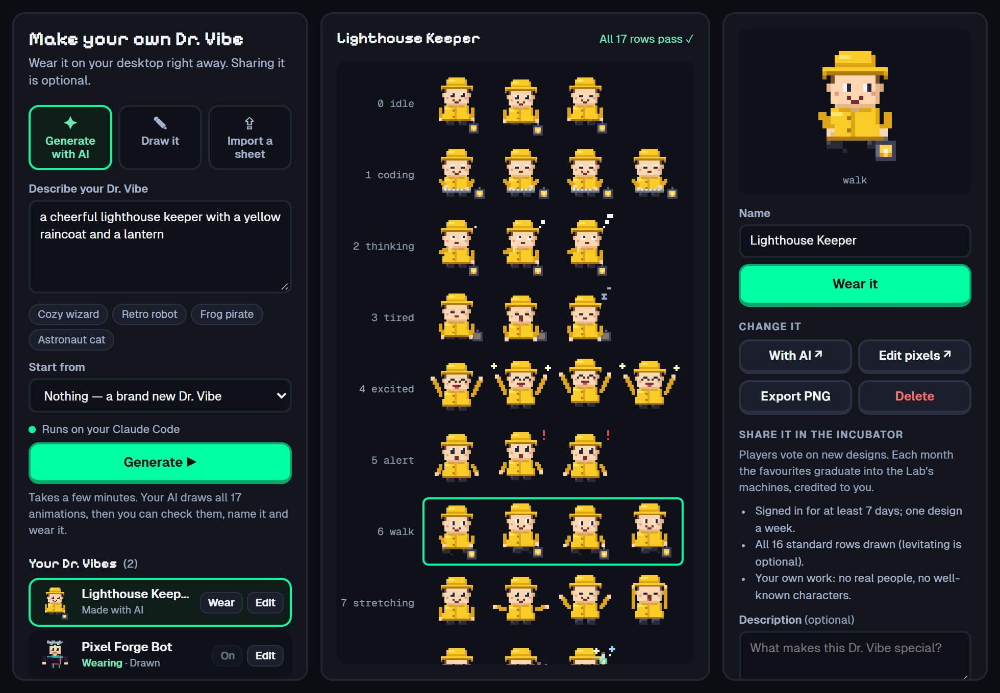

<div align="center">



# Dr. Vibe

**A pixel-art mad scientist who lives on your desktop and reacts to your coding.**

He types when you type, cheers your commits, notices when Claude Code is hammering
the same file, and reminds you to drink water. Free, open source, and fully offline
unless you choose to join the community.

[](LICENSE)
[](LICENSE-ART.md)
[](https://github.com/HardHeadHackerHead/dr-vibe-releases/releases)
[](#install)
[](https://tauri.app)

<a href="https://drvibe.io/downloads"></a>

[drvibe.io](https://drvibe.io) &nbsp;·&nbsp; [All releases](https://github.com/HardHeadHackerHead/dr-vibe-releases/releases) &nbsp;·&nbsp; [Privacy](docs/privacy.md) &nbsp;·&nbsp; [Claude Code](docs/claude-code.md) &nbsp;·&nbsp; [Skins](docs/skins.md) &nbsp;·&nbsp; [Contributing](CONTRIBUTING.md)

</div>

<p align="center">
  
</p>

## What it does

Dr. Vibe sits in a small transparent window on top of your taskbar. Everything below
works offline, with no account.

- **Reacts while you code.** He switches to his coding animation when one of about 25
  editors, IDEs and terminals has focus (VS Code, Cursor, Zed, the JetBrains IDEs,
  Neovim, Emacs, Windows Terminal, Warp, PowerShell and more), gets tired late in a
  long session, and levitates while Antigravity is active.
- **Momentum heat bar.** The bar under him runs from cold to fire as files change in
  your project folders and in Claude Code sessions.
- **Claude Code aware.** Optional hooks feed Claude Code's file activity in, so he calls
  out hotspot files, fix-test-fix loops, big refactors and new files, and sums up each
  session. [More below](#claude-code).
- **Git.** Commit celebrations, branch changes, and reminders that get more insistent
  the longer changes sit uncommitted.
- **Focus and wellness.** Pomodoro or activity-based breaks, focus mode
  (`Ctrl+Shift+F`), hydration, 20-20-20 eye breaks, posture checks, fatigue and stuck
  detection, overwork warnings, and late-night and weekend nudges. Every one can be
  switched off.
- **Progress.** 41 achievements, 5 mastery tracks, daily streaks with personal bests,
  time per language, a weekly summary and a "Today's Wins" recap when you quit.
- **Hides when it should.** He steps aside during screen shares and fullscreen apps.
- **Sound.** Eight procedural voices, synthesized live. No audio files.

<table>
  <tr>
    <td width="50%" valign="top"></td>
    <td width="50%" valign="top"></td>
  </tr>
  <tr>
    <td colspan="2"><sub><b>Dashboard</b> (tray → Dashboard): streak, momentum, mastery, today's session, personal bests, achievements, time per language and history.</sub></td>
  </tr>
</table>



**Notifications.** Achievements, breaks and reminders arrive as small toasts. Snooze
them, move them to any corner of the screen, change how long they stay, or choose which
kinds pop up in Settings → Behavior. Longer messages come from Dr. Vibe himself, in a
speech bubble.

<br clear="right">

### Visits

Friends on [drvibe.io](https://drvibe.io) can send their Dr. Vibe to your desktop. The
visitor walks on along the taskbar, the two wave, and you can wave back.

<p align="center"></p>

Visits wait while you're in focus mode, a pomodoro work block, a screen share or a
fullscreen app. At most five walk on per hour; the rest become a "visited while you
were away" note. You choose who can visit you (everyone, followers or nobody) in
Settings → Privacy. Visits need a linked account.

## Install

**Windows 10 or 11 (x64).** macOS and Linux builds aren't shipped yet.

1. Download `DrVibe_2.0.0_x64-setup.exe` from [drvibe.io/downloads](https://drvibe.io/downloads)
   or the [releases page](https://github.com/HardHeadHackerHead/dr-vibe-releases/releases).
2. Run it. It installs for your user only (no admin prompt) into a `DrVibe` folder.
   The installer and the app are Authenticode-signed (with a timestamp). New releases
   can still trip SmartScreen for a few days while Microsoft builds up the file's
   reputation; if you see "Windows protected your PC", choose **More info → Run anyway**.
   Each release lists SHA-256 checksums in `SHA256SUMS` if you want to verify the download.
3. Dr. Vibe appears above your taskbar and a short setup wizard opens.



**First run.** The wizard has five steps, and you can skip any of them or close it:

1. **Meet Dr. Vibe**
2. **Pick your look**: one of the 12 Lab Originals, a skin tone, a size and a voice
3. **Your coding setup**: the apps that count as coding and the folders that hold
   your projects
4. **Wellness**: which reminders you want
5. **Join the community** (optional): link GitHub or Discord, or skip it

After that, everything lives in the **tray icon**: right-click it for Settings,
Dashboard, Session Stats, *Make your own Dr. Vibe*, About and Quit. Drag Dr. Vibe to
move him; he walks along the taskbar on his own when you're idle.

Updates: Dr. Vibe checks drvibe.io for a new version 30 seconds after start and every
4 hours, tells you when one is out, and installs it from **About → Check for Updates**.
Updates are signed, and the app refuses one with a bad signature.

<br clear="right">

## Privacy

Dr. Vibe watches window titles and file changes so it can react, and all of that stays
on your computer. **Without an account, nothing about your coding leaves your
machine.** The only network calls are the update check and, unless you turn them
off, crash reports (the error text and app version, with your home-folder name
removed, sent only to drvibe.io).

If you link an account, the app sends your coding totals, streaks, achievements,
momentum, your Dr. Vibe's look and whether you're coding right now, every 15 minutes.
It never sends window titles, file names, file contents or code. Project names are
sent only if you switch on **Show project names** (off by default).



Settings → **Privacy** has:

- **Who sees what** on drvibe.io: profile visibility, project names, the Vibe Map,
  leaderboards, and who can visit you
- **Hide Dr. Vibe during screen shares and fullscreen apps** (on by default)
- **Share my weekly recap** (last week's totals for a share card, never project names)
- **Send crash reports** (on by default)
- **What Dr. Vibe sees**: *Show my last sync* displays the exact payload last sent,
  with a button to copy it

The full list of what's collected, where it's stored and what each switch does is in
**[docs/privacy.md](docs/privacy.md)**.

<br clear="right">

## Claude Code

Dr. Vibe reads Claude Code's activity through [hooks](https://docs.anthropic.com/en/docs/claude-code/hooks).
If Claude Code is installed (there's a `~/.claude` folder), Dr. Vibe copies a small
bash script to `~/.dr-vibe/claude-code-hook.sh` and registers it in
`~/.claude/settings.json` for `PostToolUse` (Write, Edit, NotebookEdit, Read and Bash),
`SessionStart`, `SessionEnd` and `Stop`. The script appends one line per event (event
type, tool, file path, session ID, working folder) to
`~/.dr-vibe/claude-code-events.jsonl`, which the app reads every few seconds. It never
sees your prompts, Claude's replies, commands or file contents, and nothing from the
log is sent anywhere. Without Claude Code, Dr. Vibe doesn't touch `~/.claude` at all.

With the hooks in place, Dr. Vibe:

- fills the heat bar from Claude's edits as well as yours
- comments on hotspot files, rewrite sprees, new files and cross-cutting changes
- spots fix-test-fix loops and celebrates when the tests finally pass
- sums up each session (files changed and read, top language, most-edited file)
- marks pair-programming milestones when you and Claude are both working

**Turn it on or off** in Settings → Tracking → **Follow Claude Code** (on by default).
Off removes Dr. Vibe's hooks from `~/.claude/settings.json` and keeps them out; on
puts them back, and *Install / Fix* repairs them. Restart Claude Code after a change.
While it's on, the hooks stay in place when you quit Dr. Vibe: the script only appends
to the local log (capped at 5 MB, then rotated) and always exits at once, so Claude
Code doesn't notice. On Windows the hooks run through Git Bash, which Claude Code needs
anyway. Details: **[docs/claude-code.md](docs/claude-code.md)**.

**Codex.** OpenAI's Codex CLI isn't tracked. Dr. Vibe uses Codex (or Claude Code) only
for *Make your own Dr. Vibe* below, and only when you ask it to.

## Skins and making your own



Twelve **Lab Originals** ship with the app and are free for everyone, offline, for good:
Dr. Vibe, Classic, Alien, Arctic, BridgeMind, Cyberpunk, Firefighter, Mad Scientist,
Pirate, Retro '80s, Tuxedo and Wizard. Each takes a skin tone. Switch in Settings →
Appearance.

Tray → **Make your own Dr. Vibe…** opens the workshop:

- **Generate with AI** using your own Claude Code or Codex CLI, so it runs on your plan
  and costs nothing extra.
- **Draw it yourself**: download the sprite template, import a PNG, or open the
  built-in sprite editor.
- **Preview all 17 rows**, then **wear it** right away or save it to your designs.
- **Submit to the Incubator** (linked accounts): players vote, and each month the
  favourites graduate into the Lab on drvibe.io with your name on them.

<br clear="right">

<p align="center"></p>

A skin is one PNG sprite sheet: 32 × 32 frames, 4 columns, 16 rows (128 × 512), plus
an optional 17th levitating row (128 × 544), up to 2 MB. The row order, timings, the
optional `.anim.json` sidecar and the sprite editor are covered in
**[docs/skins.md](docs/skins.md)**.

The Dr. Vibe character and the Lab Originals are licensed separately from the code,
under CC BY-NC-SA 4.0 ([LICENSE-ART.md](LICENSE-ART.md)). Designs you make are yours.

## Account linking and drvibe.io (optional)

Dr. Vibe is complete without an account. Linking adds the community at
[drvibe.io](https://drvibe.io):

- **Vibe Points** for coding (a commit, a finished pomodoro and so on), plus daily and
  weekly quests on the dashboard
- **The Machines** to pull new Dr. Vibes with your points, the **Store**, trades, and
  your collection, switchable from the tray under **My Companions**
- **Your profile and Lab**: a public page with your stats and a Lab you can decorate
- **Friends and visits**, the **Vibe Room**, leaderboards and seasons
- **The Incubator** for player-made Dr. Vibes

To link, open Settings → **Account and community** → *Continue with GitHub* or
*Continue with Discord* (13+). Your browser opens drvibe.io, and after you sign in the
site hands the app back a one-time code through a `dr-vibe://` link (PKCE, so the code
is useless to anyone else). The app trades it for a per-device token, kept in Windows
Credential Manager and never shown to the app's web views. Every request that changes
something is signed with that token. Offline, events queue on disk and send later.
Unlink from the same tab, or revoke the device from the website.

## Build from source

<details>
<summary><b>Prerequisites and commands</b></summary>

<br>

You need:

- [Node.js](https://nodejs.org/) 22
- [Rust](https://rustup.rs/) stable, with `clippy` and `rustfmt`
- The [Tauri 2 prerequisites](https://tauri.app/start/prerequisites/) for your OS
  (on Windows: Microsoft C++ Build Tools and WebView2, which Windows 11 already has)

```bash
git clone https://github.com/HardHeadHackerHead/DrVibe.git && cd DrVibe
npm ci
npm run dev:prod          # run the app against https://drvibe.io
npm run build             # release build: NSIS installer in src-tauri/target/release/bundle/nsis/
```

`npm run dev` runs the same app against a Dr. Vibe server on `http://localhost:8080`.
The server isn't part of this repository; without one, every offline feature works and
community features simply show as offline. Debug builds can switch server in Settings →
Developer (tick *Admin Mode* in the title bar to show it). Release builds always talk
to drvibe.io.

The app shares its API types with the server through the `drvibe-protocol` crate in
[`crates/drvibe-protocol/`](crates/drvibe-protocol), a path dependency of `src-tauri/`,
so a plain clone builds.

The `npm run dev*` scripts run with the identifier `com.drvibe.companion.dev`
(`src-tauri/tauri.dev.conf.json`), so a dev build keeps its own settings, stats, skins
and account link, apart from an installed Dr. Vibe, and the two can run side by side.
They do share `~/.dr-vibe` and the Claude Code hooks.

</details>

<details>
<summary><b>Tests</b></summary>

<br>

```bash
npm run check            # everything below, with a list of failures at the end
npx vitest run           # JS unit and integration tests (tests/unit, tests/e2e)
cd src-tauri
cargo fmt --check
cargo clippy --all-targets -- -D warnings
cargo test
cd ../crates/drvibe-protocol
cargo fmt --check
cargo clippy --all-targets --all-features --locked -- -D warnings
cargo test --all-features --locked
```

There is no CI, so `npm run check` is the gate before a pull request. `tests/live/` runs
end to end against a real local server and is skipped unless `DRVIBE_E2E_BRIDGE` is set
(see `scripts/e2e-live.sh`).

</details>

<details>
<summary><b>Project structure</b></summary>

<br>

```
src/                         webview side: vanilla JS, HTML5 canvas, Web Audio (no bundler)
  app.js                     the main window; wires every feature to the EventBus
  core/                      EventBus, TauriBridge, Database, PollClient, AccountState, error reporter
  core/api/                  endpoints.js (every server call), client.js, contract.js
  features/                  one folder per feature: character, activity, timer, session,
                             achievements, streak, focus, hydration, posture, eyestrain,
                             sound, visits, economy, companion, presence, privacy, make, ...
  ui/                        panels, the dashboard's Community tab, "What Dr. Vibe sees"
  config/                    animation rows and timing, skin tones, Lab Original names
  assets/sprites/skins/      the 12 Lab Originals (PNG + .anim.json)
  *.html                     one file per window: settings, dashboard, setup wizard, make,
                             character workshop, sprite editor, visitor, toasts, speech, ...
src-tauri/src/               Rust side (Tauri 2)
  main.rs                    setup and command registration
  api.rs                     the one HTTP client: device token, request signing
  account.rs                 server URL, OS keyring token, PKCE device linking
  sync.rs                    the profile sync payload
  claude_hooks.rs            Claude Code hook install and event log
  skins.rs                   local skin library and imports
  generator.rs               Make your own Dr. Vibe via the claude / codex CLI
  presence.rs                screen share and fullscreen detection
  projects.rs, watcher.rs    project discovery, git inspection, file watcher
  tray.rs, panels.rs         tray menu and panel windows
  updates.rs                 What's New and the auto-updater
  error_reports.rs           crash report queue and panic hook
crates/drvibe-protocol/      API payload types shared with the server
tools/                       Claude Code hook scripts, generator prompt
scripts/                     check, release, skin baking, installer images
tests/                       vitest suites
```

Modules talk through the **EventBus** rather than calling each other. JavaScript never
calls the server itself: it names a call in `src/core/api/endpoints.js`, and Rust adds
the token, signs it and checks the body against `drvibe-protocol`. See
[CONTRIBUTING.md](CONTRIBUTING.md) for how to add a feature, and
[STATE-REFERENCE.md](STATE-REFERENCE.md) for what triggers each animation.

</details>

## Contributing

Bug reports, fixes and features are welcome. Start with
[CONTRIBUTING.md](CONTRIBUTING.md), run `npm run check` before you open a pull request,
and keep Dr. Vibe's voice: short, warm, second-person hype ("Five files and counting!").
Security issues: see [docs/security.md](docs/security.md). Releases are cut by the
maintainer ([RELEASING.md](RELEASING.md)).

## License

- **Code:** [GNU AGPL-3.0](LICENSE).
- **Art:** the Dr. Vibe character, the 12 Lab Originals and the brand art (icons,
  installer images, screenshots and GIFs in `docs/images/`) are
  [CC BY-NC-SA 4.0](LICENSE-ART.md). Fork the app freely; don't sell the character.
- **Fonts:** Pixelify Sans, Geist Sans and Geist Mono, under the SIL Open Font License
  (`src/assets/fonts/`).
- The names "Dr. Vibe" and "drvibe.io" aren't licensed for forks to use as their own.

## Credits

Dr. Vibe is made by David Hacker and the Dr. Vibe contributors. Built with
[Tauri](https://tauri.app); type set in [Pixelify Sans](https://fonts.google.com/specimen/Pixelify+Sans)
and [Geist](https://vercel.com/font). Releases are code-signed with
[QwickCert](https://qwickcert.dev).
