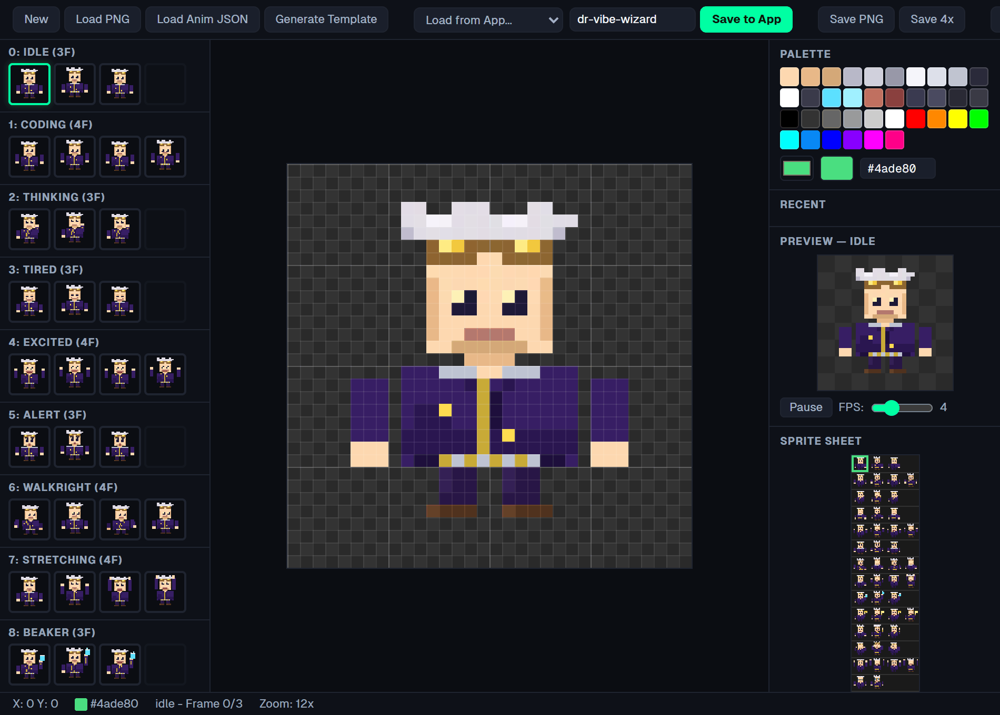

# Skins: the sprite format and making your own

Every Dr. Vibe, bundled or player-made, is one PNG sprite sheet, plus optional
animation settings. The format is shared with drvibe.io, so a sheet that works on your
desktop also works on the site.

## The Lab Originals

Twelve sheets ship in `src/assets/sprites/skins/`: Dr. Vibe (`default`), Classic, Alien,
Arctic, BridgeMind, Cyberpunk, Firefighter, Mad Scientist, Pirate, Retro '80s, Tuxedo
and Wizard. They're free for everyone, offline. Each takes a runtime skin tone (a
palette swap, `src/config/skinTones.js`). They're fixed: new Dr. Vibes come from
players through the Incubator on drvibe.io, not from pull requests to this repo.

## Sheet format

- **Frames:** 32 × 32 px, 4 columns.
- **Size:** 128 × 512 (16 rows), or 128 × 544 with the optional 17th levitating row.
- **File:** PNG with a transparent background, up to 2 MB. Draw hard pixels with no
  anti-aliasing; the app scales them up with nearest-neighbour sampling.

| Row | Animation | Frames | Row | Animation | Frames |
| --- | --- | --- | --- | --- | --- |
| 0 | `idle` | 3 | 9 | `libraryCard` | 4 |
| 1 | `coding` | 4 | 10 | `thumbsUp` | 3 |
| 2 | `thinking` | 3 | 11 | `coverEyes` | 3 |
| 3 | `tired` | 3 | 12 | `celebrating` | 4 |
| 4 | `excited` | 4 | 13 | `focused` | 2 |
| 5 | `alert` | 3 | 14 | `concerned` | 3 |
| 6 | `walk` (mirrored for walking left) | 4 | 15 | `presenting` | 3 |
| 7 | `stretching` | 4 | 16 | `levitating` (optional) | 4 |
| 8 | `beaker` | 3 | | | |

Frame timings and behaviours (loop, play once, revert after a few seconds) live in
[`src/config/animations.js`](../src/config/animations.js). Sheets without row 16 use
the idle frames while levitating. What triggers each state is in
[STATE-REFERENCE.md](../STATE-REFERENCE.md). The checks are in
[`src/features/make/spriteSpec.js`](../src/features/make/spriteSpec.js), which mirrors
the server's rules:

- **Wearable** on your desktop: the size is right and the idle and walk rows are drawn.
- **Submittable** to the Incubator: the first two frames of each of the 16 standard rows
  are at least 5 % drawn.

## Animation settings (`.anim.json`)

A sheet can carry extra animation settings. The Lab Originals have them in a
`.anim.json` next to the PNG, and also baked into the PNG's pixel data (the two lowest
bits of each colour channel, starting at the top-left pixel, after a `DRVB` header), so
a single PNG carries everything. All keys are optional:

| Key | What it does |
| --- | --- |
| `idleMicroMotion` | Breathing (`period`, `scaleY`) and sway (`period`, `offsetX`) while idle |
| `squashStretch` | Per-animation squash and stretch (`scaleX`, `scaleY`, `speed`) |
| `idleFlourishes` | Weighted idle actions such as looking around or tapping a foot |
| `walk` | Walking speed and the idle time between walks |
| `bonusAnimations` | Extra rows beyond the standard 17 |
| `vibeId` | A stable ID for the design |
| `generation` | How the sheet was made (tool, model, prompt, date) |

Because the baked settings live in the low bits, recolouring or re-encoding a Lab
Original's rows breaks them. Edit the PNG and its `.anim.json`, then re-bake with
`scripts/bake-skins.cjs`.

## Making your own

Open tray → **Make your own Dr. Vibe…**, or Settings → Appearance → **Make your own
Dr. Vibe**. It always opens on a fresh "Describe your Dr. Vibe…" prompt, with three ways in:

- **Generate with AI.** Describe a Dr. Vibe (or pick an idea), optionally start from a
  Lab Original or one of yours, and press **Generate**. Your own Claude Code (`claude`)
  or Codex (`codex`) CLI draws all 17 rows using the prompt in
  [`tools/generate-character.md`](../tools/generate-character.md). It runs on your plan,
  on your machine, and takes a few minutes; you can cancel. Install one with
  `npm i -g @anthropic-ai/claude-code` or `npm i -g @openai/codex` and sign in to it once
  in a terminal. When both are installed you pick which one to use.
- **Draw it.** Open the sprite editor on a blank sheet or on a copy of a Lab Original, or
  download the template (a 128 × 544 sheet and a row guide) for any pixel editor.
- **Import a sheet.** Choose a PNG; it is checked before you wear or save it.

The middle pane shows every row with its check; click a row to watch it move. Then
**Wear it**, rename it, or change it: **With AI** opens the workshop to fix one animation
or regenerate the whole character (you compare before and after), and **Edit pixels**
opens it in the sprite editor. **Export PNG** saves the sheet and its `.anim.json` to
Downloads, and **Delete** removes it. A Lab Original can't be changed; **Remix it as my
own** makes a copy you can. Everything you made is listed under **Your Dr. Vibes**;
Settings → Appearance → **Edit this character** opens the selected one here.

**Submit to the Incubator** if you're linked (for at least 7 days; one design a week).
Players vote on submissions, and each month the favourites graduate into the Lab on
drvibe.io with the creator's name on them. Designs you make are yours; by submitting you
confirm it is your own work and agree to the
[upload terms](https://drvibe.io/terms#uploads).

Your designs are stored in `%APPDATA%\com.drvibe.companion\skins\`. A new design never
replaces an existing one: a name that's taken gets a `-2`, `-3`, … suffix.

## The sprite editor

A frame-by-frame pixel editor for the whole 17-row sheet: every row and frame on the
left, a zoomed canvas, a palette with recent colours, a live animation preview with
adjustable speed, and the full sheet. It can start blank, open any installed Dr. Vibe
(*Open a Dr. Vibe…*; a Lab Original opens as a copy), load a PNG or an `.anim.json`,
generate the template, and **Save to my Dr. Vibes** (it asks before replacing one of
yours) or export the sheet at 1× or 4×.

## Licence

The Lab Originals and the Dr. Vibe character are licensed under CC BY-NC-SA 4.0, not
the AGPL; see [LICENSE-ART.md](../LICENSE-ART.md). You may remix them for
non-commercial use with credit, under the same licence. Characters you draw from
scratch are your own.
